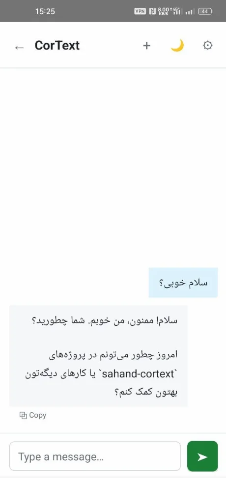

# CorText Chat — Android app (main chat only)

The Android companion for **[Sahand-CorText](https://github.com/sahand363/sahand-cortext)**,
the self-hosted AI workspace. It is a minimal client for the hub's
main chat — nothing else; the other capabilities stay in the web UI.
You need a running Sahand-CorText hub to use it (see
[Setup](#setup) below).

**Download:** the latest APK is on the
[Releases](https://github.com/sahand363/sahand-cortext-android/releases) page.

<p align="center"></p>

- Package `com.sahand.cortextchat`, version 1.4.3 (versionCode 10).
- Three screens: **Chat list**, **Chat**, and **Settings**. No tabs,
  no sidebar.
- No third-party dependencies: Android framework + Kotlin stdlib only,
  `HttpURLConnection` for networking (same approach as SMS Cleaner).
- Design matches the CorText panel (its exact colours and fonts, both
  themes): light by default, dark via the sun/moon toggle. The fonts
  are the panel's own — DM Sans (body) + Manrope Bold (titles) +
  Vazirmatn (Persian/Arabic fallback) — bundled under
  `app/src/main/res/font/` (all OFL-licensed; DM Sans + Manrope from
  `@expo-google-fonts`, Vazirmatn from `@expo-google-fonts/vazirmatn`).
- **Chat list**: the hub's chats (pinned first, then most recent —
  the same list the web panel shows, so a chat started in either
  place appears in the other). Tap to open; long-press for
  Pin/Unpin and Delete (delete asks first); "+" starts a new chat.
- Settings has a **Model** picker (the hub's models, via
  `POST /api/mobile/models`; "Hub default" uses the hub's active
  model), a **Persona** picker (the hub's personas, via
  `GET /api/mobile/personas`; "Main chat" uses no persona), and a
  **← back button** that returns to the chat without saving.
  Picking a persona starts a NEW session with that persona — the old
  chat keeps its history in the list, untouched.
- **Streaming replies**: the AI reply appears word-by-word as it
  arrives (`POST /api/mobile/chat/stream`, encrypted SSE), instead of
  waiting for the whole reply. On a hub without the stream endpoint
  it falls back to the buffered send. Scroll anchoring: when a reply
  starts, a few lines of the question stay visible at the top and the
  reply begins below; while streaming it only follows to the bottom
  while the user is already there — scrolling up to read stops the
  auto-scroll until they scroll back down.
- **Reply sync (1.4.3)**: if a stream ends without the reply on screen
  — cut before `done` by a proxy or the network, or a model that
  answered without streaming any text — the app fetches the chat
  history from the hub instead of dropping the bubble (and re-checks a
  few times while the hub finishes), so you never have to close and
  reopen the chat to see an answer. A network error mid-stream no
  longer retries on the other scheme (that re-sent the message).

## Setup

1. Install [Sahand-CorText](https://github.com/sahand363/sahand-cortext)
   on your server (its one-line installer) and open the web panel.
2. In the panel, open **Mobile App** and turn mobile access on. The
   page shows the **token** and the hub's port.
3. Install the APK on your phone and open **Settings**:
   - **Server**: the hub's IP or domain (or the relay's, see below).
   - **Mode**: *Direct* or *Relay*.
   - **Port**: the hub's port from the Mobile App page (8787 on a
     default install), or the relay's port (8080 by default).
   - **Token**: paste the token from the Mobile App page.
4. Tap **Save**. The app checks that the hub is reachable and accepts
   the token, then opens your chats.

## How it connects

```
Direct:  Android app  ──encrypted──▶  Sahand-CorText hub  ──▶  AI providers
Relay:   Android app  ──encrypted──▶  cortext-relay  ──▶  hub  ──▶  AI providers
```

The hub owns the mobile feature: the app only talks to the hub's
`/api/mobile/*` endpoints. The AI providers only ever see the hub —
never your phone or its IP. Chats are the same ones the web panel
shows, so a chat started in one place continues in the other.

- **Direct mode**: the app connects straight to the hub. Use it when
  the phone can reach the hub's port (same network, VPN, or an open
  port). If you put the hub behind a domain with HTTPS (the control
  menu's Caddy option), use the domain and port 443.
- **Relay mode**: the app connects to `cortext-relay` on a middle
  server, which forwards to the hub. Useful when the hub itself should
  not be exposed, or the phone reaches the middle server more easily.
  The relay is a dumb pass-through: it holds no token, never
  decrypts, and streams replies through chunk by chunk. The hub's
  Mobile App page gives a one-line command to install and start it.
- **The token is the only credential**. It is both the encryption key
  (`SHA-256(token)`) and the proof of access: the hub checks it by
  decrypting the request, so the token itself never crosses the
  network. No username, no password. Regenerating it on the hub's
  Mobile App page locks out the old one.
- **Encryption**: every request and reply is encrypted with the token
  (HMAC-SHA256 stream cipher with a MAC, see `Crypto.kt`) before it
  touches the network, so chats stay private even over plain HTTP.
  TLS, when you have it, is a second layer. The app runs a known test
  vector on startup as a self-check.
- **SSL setting**: *Auto* (default) tries HTTPS first and falls back
  to HTTP, remembering what worked, and re-tries HTTPS hourly, so it
  upgrades on its own once you add a certificate. *On* = HTTPS only,
  *Off* = HTTP only.
- **Activation**: Save (and "Test connection") runs two checks: a
  plain `GET /api/mobile/health` (is the hub reachable, is mobile
  access on?) and an encrypted `POST /api/mobile/sessions` (does the
  hub accept this token?).
- **Replies stream** over `POST /api/mobile/chat/stream` (encrypted
  server-sent events): the answer appears word by word. While a model
  is thinking, the hub sends a heartbeat every 15s so proxies keep the
  connection open; if the stream still drops, the app pulls the
  finished reply from the hub's history.
- **Timeouts**: 10s to connect, 600s to read (a model can take
  minutes).

## Screens

- **Chat list** (shown on open, once configured): the hub's chats,
  pinned first. Tap to open, long-press for Pin/Unpin/Delete,
  "+" for a new chat, gear for Settings, sun/moon for the theme.
- **Settings** (shown on first launch): mode, host, port, token, SSL,
  theme, model picker, persona picker. "Save & open chat",
  "Test connection", "Log out" (clears the token and the session).
  Saving reuses the current session unless the server/token or the
  persona changed — a persona change opens a NEW session with that
  persona and keeps the old chat in the list.
- **Chat**: top bar (CorText, new chat, theme toggle, settings gear),
  message list (user right, assistant left, panel bubble colours),
  "Thinking…" while the reply is on its way, input row at the bottom
  with the panel's 8dp input + accent ➤ send button. History loads
  on open. A plain error message is shown if the hub/relay is
  unreachable. Back returns to the chat list.
- **Theme**: dark/light toggle in the top bar (and in Settings),
  persisted, switches immediately. Light is the default (panel light:
  white bg, green `#1a7f37` accent); dark is the panel dark (bg
  `#0b0d12`, lime `#c3f47a` accent, bubbles `#202936` / `#151b26`).

## Notes

- `android:usesCleartextTraffic="true"` is set on purpose: the app
  talks plain HTTP to a bare IP first. The content is still encrypted
  by the app-layer cipher (see above).
- The token is stored in plain `SharedPreferences` (app-private).
  That is deliberate: `EncryptedSharedPreferences` needs the AndroidX
  Security library, and this app has zero third-party dependencies.
  See the note in `SettingsStore.kt`.
- A self-signed certificate is NOT trusted: in Auto mode an HTTPS
  attempt that fails certificate validation falls back to HTTP. The
  chat is still encrypted by the token. A valid (e.g. Let's Encrypt)
  certificate is used automatically.
- Upgrading from v1.0.0: the old username/password/tunnel key are
  ignored. Open the app, paste the token from the hub's Mobile page,
  and save — that activates it.

## Download (GitHub Actions)

Every push to `main` builds the APK in GitHub Actions
(`.github/workflows/android.yml`) and publishes it on the
**Releases** page as `CorText-Chat-v<version>.apk` (tag `v<version>`,
from `versionName` in `app/build.gradle.kts`). It is signed with the
committed `debug.keystore`, so it installs over earlier builds.
Bump `versionCode`/`versionName` for a new release; pushing without a
bump replaces that release's APK.

## Build

On a normal machine / in Android Studio:

```
gradle assembleDebug
```

Here (the sandbox blocks the Gradle daemon's Java-to-Java TCP), use
the manual script — same approach as SMS Cleaner. Requires the
Android SDK (platform 34 + build-tools 34.0.0), JDK 17, Kotlin
2.0.0:

```
export JAVA_HOME=$HOME/android-build/jdk-17.0.21+9
export ANDROID_SDK_ROOT=$HOME/android-sdk
export KOTLINC_HOME=$HOME/android-build/kotlinc
./build-manual.sh
```

This produces `build/manual/app-debug.apk`. It is signed with the
`debug.keystore` in the project root, so rebuilds install over each
other. The keystore is committed on purpose (Actions signs with it);
it is a debug key, not a Play Store key.

Note: `d8` prints a harmless warning about "malformed kotlin.Metadata"
(kotlinc 2.0.0 is newer than the R8 bundled with build-tools 34.0.0).
The APK still builds and verifies fine — SMS Cleaner's toolchain
produces the same warning.
